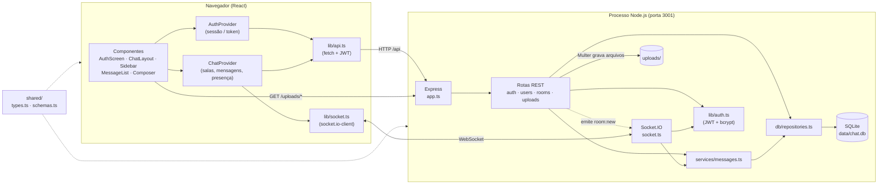
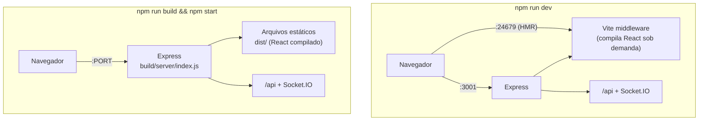
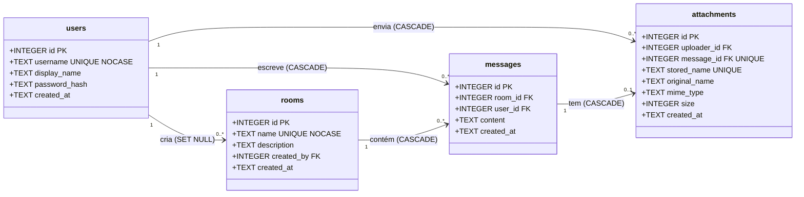
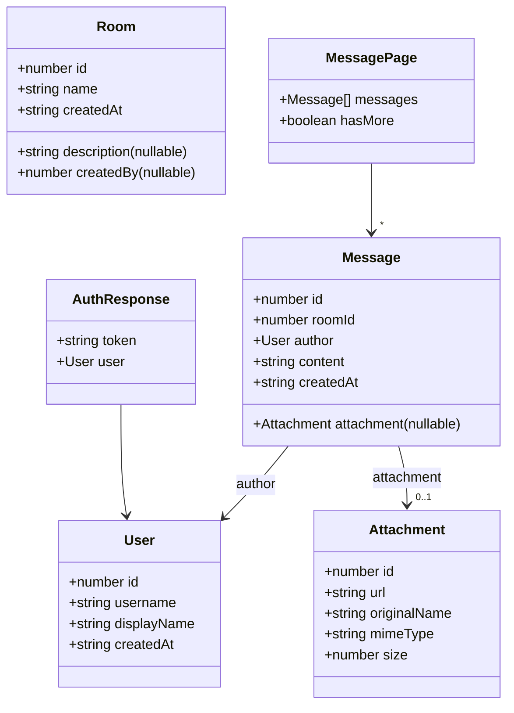
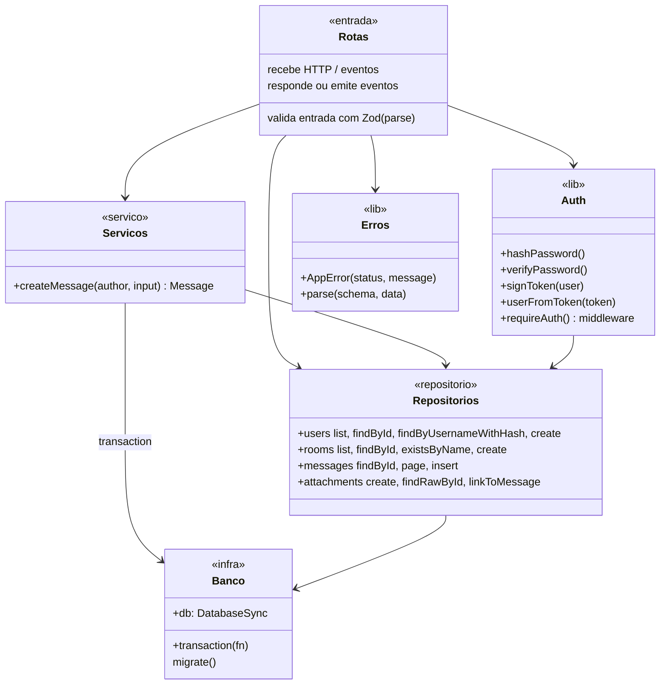
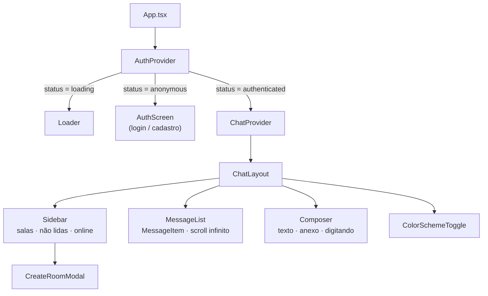
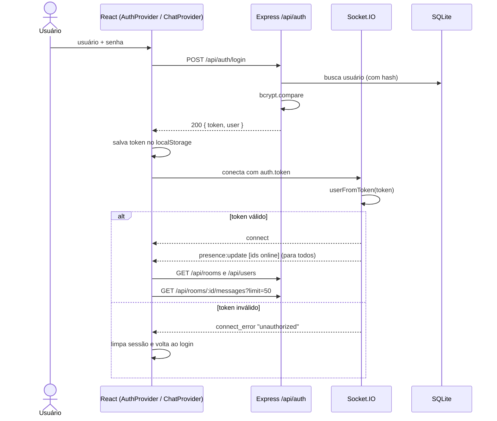
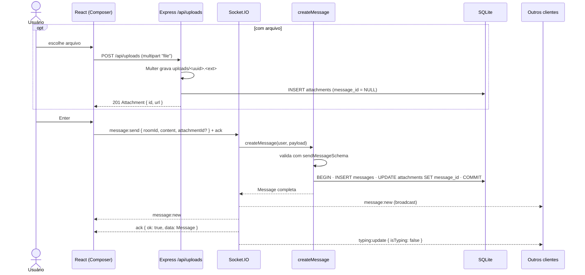
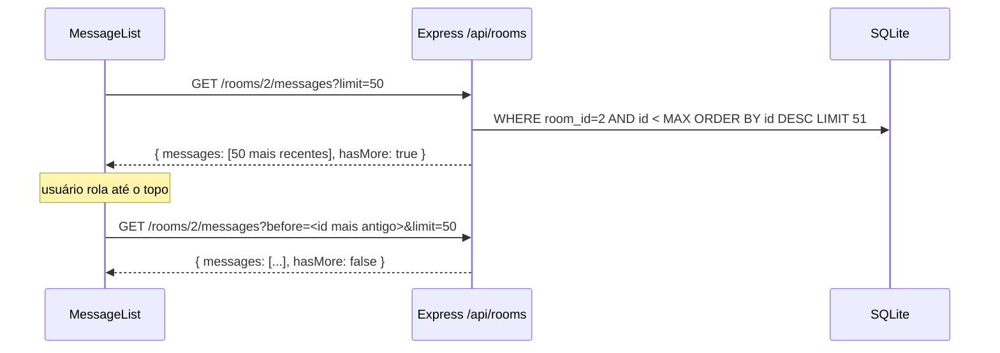
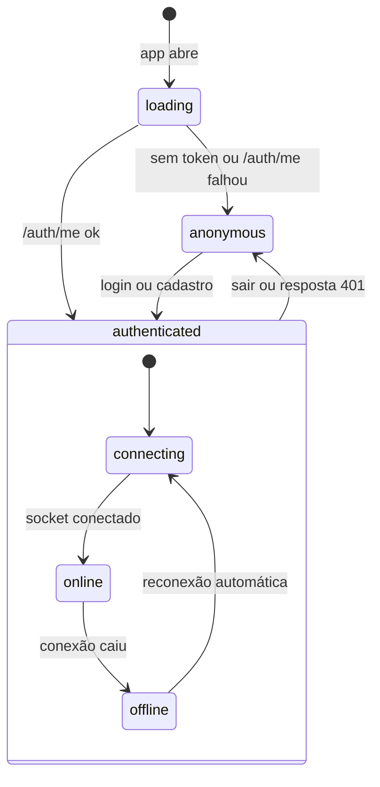

# chat-bot-monolito

Sistema de comunicação em tempo real: **Node.js (Express + Socket.IO + SQLite)** servindo um front-end **React** no
mesmo processo e na mesma porta, tudo em **TypeScript**.

Funcionalidades: cadastro e login com JWT, salas públicas, mensagens em tempo real com histórico paginado, envio de
arquivos e imagens, indicador de "digitando…", lista de usuários online, contador de não lidas e tema claro/escuro.

## Sumário

- [Stack](#stack)
- [Como rodar](#como-rodar)
- [Dados de exemplo (seed) e login de teste](#dados-de-exemplo-seed-e-login-de-teste)
- [Variáveis de ambiente](#variáveis-de-ambiente)
- [Scripts](#scripts)
- [Arquitetura (UML)](#arquitetura-uml)
  - [Visão geral: diagrama de componentes](#visão-geral-diagrama-de-componentes)
  - [Implantação: dev × produção](#implantação-dev--produção)
  - [Modelo de dados: diagrama de classes](#modelo-de-dados-diagrama-de-classes)
  - [Camadas do back-end](#camadas-do-back-end)
  - [Front-end](#front-end)
  - [Fluxos: diagramas de sequência](#fluxos-diagramas-de-sequência)
  - [Estados da sessão no cliente](#estados-da-sessão-no-cliente)
- [API REST](#api-rest)
- [Eventos do Socket.IO](#eventos-do-socketio)
- [Banco de dados e migrações](#banco-de-dados-e-migrações)
- [Segurança](#segurança)
- [Estrutura de pastas](#estrutura-de-pastas)

## Stack

| Camada      | Tecnologias                                                                         |
| ----------- | ----------------------------------------------------------------------------------- |
| Back-end    | Express 5, Socket.IO 4, SQLite (`node:sqlite`, nativo), JWT, bcrypt, Multer, Zod    |
| Front-end   | React 19, Mantine 9 (componentes e tema claro/escuro), SCSS no padrão BEM, Tabler Icons |
| Compartilhado | Tipos (`shared/types.ts`) e schemas Zod (`shared/schemas.ts`) usados pelos dois lados |
| Ferramentas | TypeScript, Vite (middleware em dev), tsx                                           |

## Como rodar

Requisito: **Node.js 22.13 ou superior** (o SQLite usado é o módulo nativo `node:sqlite`).

```bash
npm install
cp .env.example .env   # opcional: sem .env, os valores padrão são usados
npm run seed           # opcional: cria usuários, salas e conversas de exemplo
npm run dev
```

Acesse **http://localhost:3001**. Em desenvolvimento o Vite roda dentro do Express, então front-end, API e WebSocket
ficam na mesma porta, com hot reload.

## Dados de exemplo (seed) e login de teste

```bash
npm run seed                                        # 12 usuários, 6 salas, ~600 mensagens dos últimos 30 dias
npm run seed -- --reset                             # apaga TUDO (banco e uploads/) e recria
npm run seed -- --reset --messages 2000 --days 90   # mais volume, período maior
npm run seed -- --seed 7                            # outra semente = outros dados (mesma semente = mesmos dados)
```

**Senha de todos os usuários: `senha123`**

| Usuário           | Nome            |
| ----------------- | --------------- |
| `ana.souza`       | Ana Souza       |
| `bruno.lima`      | Bruno Lima      |
| `carla.mendes`    | Carla Mendes    |
| `diego.alves`     | Diego Alves     |
| `elisa.rocha`     | Elisa Rocha     |
| `felipe.costa`    | Felipe Costa    |
| `gabi.nunes`      | Gabi Nunes      |
| `heitor.dias`     | Heitor Dias     |
| `isabela.martins` | Isabela Martins |
| `joao.pereira`    | João Pereira    |
| `larissa.gomes`   | Larissa Gomes   |
| `marcos.ribeiro`  | Marcos Ribeiro  |

Para ver o tempo real funcionando, abra duas janelas (uma anônima) e entre com usuários diferentes.

O que a seed gera:

- **Salas:** `geral`, `dev`, `design`, `suporte`, `random` e `anuncios`, cada uma com descrição.
- **Conversas** roteirizadas por assunto (code review, deploy, suporte, avisos…) misturadas com respostas curtas,
  concentradas em horário comercial e com respostas de 10 s a 10 min depois da anterior.
- **Anexos** em ~6% das mensagens: imagens PNG, CSV ou TXT gerados na hora e gravados em `uploads/`.

Observações:

- Sem `--reset`, a seed não roda duas vezes (avisa que já foi aplicada).
- `--reset` **apaga todos os dados**, inclusive usuários e arquivos criados manualmente.
- Em produção a seed é bloqueada; `--force` ignora o bloqueio.

## Variáveis de ambiente

Lidas do `.env` (se existir) e validadas com Zod em [server/config/env.ts](server/config/env.ts). Valor inválido
encerra o processo com uma mensagem clara.

| Variável        | Padrão         | Descrição                                                         |
| --------------- | -------------- | ----------------------------------------------------------------- |
| `NODE_ENV`      | `development`  | `development`, `production` ou `test`                             |
| `PORT`          | `3001`         | Porta HTTP (API + WebSocket + front-end)                          |
| `HMR_PORT`      | `24679`        | Porta do WebSocket de hot reload do Vite (apenas dev)             |
| `DB_PATH`       | `data/chat.db` | Arquivo do SQLite                                                 |
| `JWT_SECRET`    | segredo de dev | **Obrigatório em produção**, mínimo 32 caracteres                 |
| `UPLOAD_DIR`    | `uploads`      | Pasta dos arquivos enviados                                       |
| `MAX_UPLOAD_MB` | `10`           | Tamanho máximo por arquivo                                        |

## Scripts

| Script              | Descrição                                                              |
| ------------------- | ---------------------------------------------------------------------- |
| `npm run dev`       | Desenvolvimento: Express + Vite como middleware, com hot reload        |
| `npm run seed`      | Popula o banco com usuários, salas, conversas e anexos de exemplo      |
| `npm run typecheck` | Checa os tipos do back-end e do front-end                              |
| `npm run build`     | Typecheck + build do React em `dist/` + compila o servidor em `build/` |
| `npm start`         | Produção: Express serve a API, o WebSocket e o build de `dist/`        |

## Arquitetura (UML)

É um **monólito**: um único processo Node.js atende o front-end, a API REST e o WebSocket na mesma porta. Isso dispensa
CORS e simplifica a implantação. A comunicação segue duas vias:

- **REST (`/api`)**: operações de "pedido e resposta" (login, listar salas, histórico, upload de arquivo).
- **Socket.IO**: tudo que é tempo real (enviar e receber mensagens, digitando, presença, salas novas).

Os diagramas abaixo usam [Mermaid](https://mermaid.js.org/), renderizado automaticamente pelo GitHub e pelo VS Code
(com a extensão de preview de Mermaid).

### Visão geral: diagrama de componentes



### Implantação: dev × produção



Em produção, qualquer `GET` que não seja da API nem de `/uploads` devolve o `dist/index.html` (fallback de SPA).

### Modelo de dados: diagrama de classes

Tabelas do SQLite (ver [server/db/index.ts](server/db/index.ts)) e os tipos que trafegam na API
([shared/types.ts](shared/types.ts)).



Regras importantes:

- Um anexo nasce **sem mensagem** (`message_id = NULL`) no upload e é vinculado quando a mensagem é enviada. Cada anexo
  só pode ser usado em uma mensagem (`UNIQUE`).
- A paginação do histórico usa o `id` da mensagem como cursor, por isso os ids crescem na mesma ordem das datas.
- `password_hash` nunca sai do servidor: o tipo `User` da API não tem esse campo.

Tipos expostos pela API:



### Camadas do back-end



Arquivos de cada camada: entrada = `routes/*.ts` e `socket.ts`; serviço = `services/messages.ts`;
repositório = `db/repositories.ts`; infra = `db/index.ts`; lib = `lib/auth.ts` e `lib/errors.ts`.

- **Rotas** só tratam transporte (HTTP/socket) e validação. Erros esperados são lançados como `AppError` e viram JSON
  `{ "error": "..." }` no `errorHandler` de [server/app.ts](server/app.ts).
- **Serviços** concentram regras que são usadas por mais de uma entrada. `createMessage` é usado pelo socket e
  valida sala, dono do anexo e vínculo único, tudo dentro de uma transação.
- **Repositórios** são o único lugar com SQL; convertem linhas `snake_case` para os tipos `camelCase` de `shared/`.

### Front-end



- **AuthProvider** ([client/src/auth/AuthProvider.tsx](client/src/auth/AuthProvider.tsx)): guarda o token no
  `localStorage`, valida com `GET /api/auth/me` ao abrir e volta para a tela de login em qualquer `401`.
- **ChatProvider** ([client/src/chat/ChatProvider.tsx](client/src/chat/ChatProvider.tsx)): estado central do chat
  (salas, mensagens por sala, não lidas, quem está digitando, usuários e presença). Abre o socket com o token e assina
  os eventos do servidor.
- **lib/api.ts**: wrapper do `fetch` que injeta o `Authorization: Bearer` e transforma erros da API em `HttpError`.
- **lib/socket.ts**: instância única e tipada do `socket.io-client`.

### Fluxos: diagramas de sequência

#### Login e conexão em tempo real



#### Envio de mensagem com anexo



#### Histórico com scroll infinito (paginação por cursor)



### Estados da sessão no cliente



## API REST

Todas as rotas ficam em `/api`. Exceto `health`, `register` e `login`, todas exigem `Authorization: Bearer <token>`.
Erros sempre voltam como `{ "error": "mensagem" }`.

| Método | Rota                                         | Descrição                                     | Resposta            |
| ------ | -------------------------------------------- | --------------------------------------------- | ------------------- |
| GET    | `/api/health`                                | Saúde do servidor                             | `HealthResponse`    |
| POST   | `/api/auth/register`                         | Cria conta `{ username, displayName, password }` | `201 AuthResponse` |
| POST   | `/api/auth/login`                            | Login `{ username, password }`                | `AuthResponse`      |
| GET    | `/api/auth/me`                               | Usuário do token                              | `User`              |
| GET    | `/api/users`                                 | Lista usuários                                | `User[]`            |
| GET    | `/api/rooms`                                 | Lista salas                                   | `Room[]`            |
| POST   | `/api/rooms`                                 | Cria sala `{ name, description? }` e emite `room:new` | `201 Room`  |
| GET    | `/api/rooms/:id/messages?before=&limit=`     | Histórico paginado (`limit` até 100, padrão 50) | `MessagePage`     |
| POST   | `/api/uploads`                               | Upload multipart (campo `file`)               | `201 Attachment`    |
| GET    | `/uploads/<arquivo>`                         | Download do arquivo enviado                   | arquivo             |

Validações (de [shared/schemas.ts](shared/schemas.ts)): usuário com 3 a 32 caracteres (`a-z`, `0-9`, `_`, `.`),
senha de 8 a 72, nome da sala de 2 a 40, mensagem até 4000 caracteres.

## Eventos do Socket.IO

O cliente conecta enviando o JWT em `auth.token`. Sem token válido a conexão é recusada (`unauthorized`).

| Direção            | Evento            | Payload                                        |
| ------------------ | ----------------- | ---------------------------------------------- |
| cliente → servidor | `message:send`    | `{ roomId, content, attachmentId? }` + ack `{ ok, data \| error }` |
| cliente → servidor | `typing:set`      | `{ roomId, isTyping }`                         |
| servidor → todos   | `message:new`     | `Message`                                      |
| servidor → todos   | `room:new`        | `Room`                                         |
| servidor → outros  | `typing:update`   | `{ roomId, user: { id, displayName }, isTyping }` |
| servidor → todos   | `presence:update` | `number[]` (ids online)                        |

Presença: um usuário fica online enquanto tiver pelo menos uma conexão aberta (várias abas contam como uma pessoa).
Ao desconectar, o servidor limpa automaticamente o "digitando" daquele socket.

## Banco de dados e migrações

- SQLite em modo WAL, com chaves estrangeiras ativas.
- Migrações versionadas pelo `PRAGMA user_version`, aplicadas automaticamente ao subir o servidor (ou a seed).
- Para alterar o esquema, **adicione uma nova migração no final** do array em [server/db/index.ts](server/db/index.ts).
  Nunca edite uma migração já aplicada.
- A migração inicial já cria a sala `geral`.

## Segurança

- Senhas com **bcrypt**; o login leva o mesmo tempo quando o usuário não existe (evita descobrir usuários pelo tempo).
- **JWT HS256** com validade de 7 dias; segredo obrigatório e forte em produção.
- Toda entrada é validada com **Zod**, inclusive os eventos do socket.
- Uploads salvos com nome aleatório (UUID). Na hora de servir: `nosniff`, `Content-Security-Policy: sandbox`, e só
  imagens abrem no navegador (o resto é forçado a download), impedindo que um HTML/SVG enviado execute scripts.
- Um anexo só pode ser usado por quem o enviou e em uma única mensagem.
- Limites de tamanho: corpo JSON 100 KB, mensagens do socket 64 KB, arquivos `MAX_UPLOAD_MB`.

## Estrutura de pastas

```
server/                 back-end
  index.ts              ponto de entrada (HTTP + Vite em dev / estáticos em prod)
  app.ts                app Express, rotas da API (/api) e tratamento de erros
  socket.ts             servidor Socket.IO (autenticação, mensagens, digitando, presença)
  config/env.ts         leitura e validação das variáveis de ambiente
  db/index.ts           conexão SQLite, migrações e transação
  db/repositories.ts    consultas SQL (users, rooms, messages, attachments)
  db/seed.ts            dados de exemplo (npm run seed)
  routes/               rotas REST: auth, users, rooms, uploads
  services/messages.ts  regra de criação de mensagens
  lib/auth.ts           JWT, bcrypt e middleware requireAuth
  lib/errors.ts         AppError e helper de validação
client/                 front-end (React + Vite)
  src/App.tsx           escolhe entre login e chat conforme a sessão
  src/auth/             AuthProvider (sessão)
  src/chat/             ChatProvider (estado do chat e eventos do socket)
  src/components/       componentes, cada um com seu .tsx e .scss (BEM)
  src/lib/              cliente da API, socket e formatação
  src/styles/           estilos globais, variáveis e mixins SCSS
shared/
  types.ts              tipos compartilhados (entidades, API e eventos do socket)
  schemas.ts            validações Zod usadas no back e no front
data/                   banco SQLite (não versionado)
uploads/                arquivos enviados (não versionado)
```
